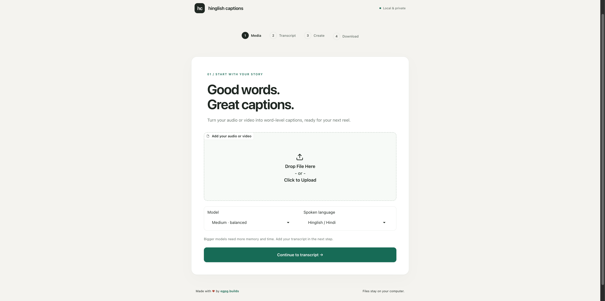
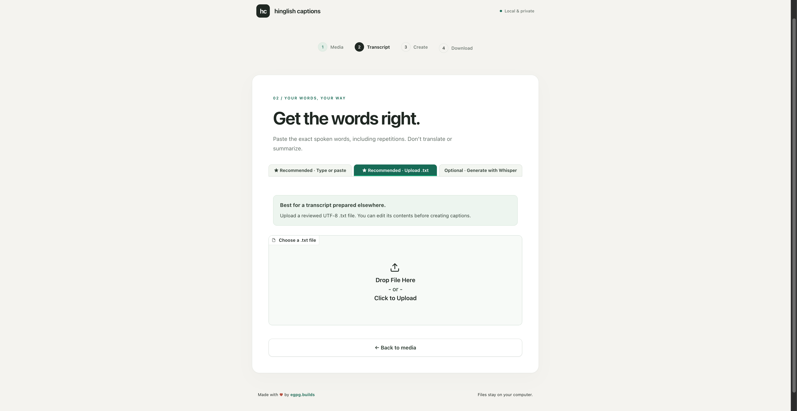
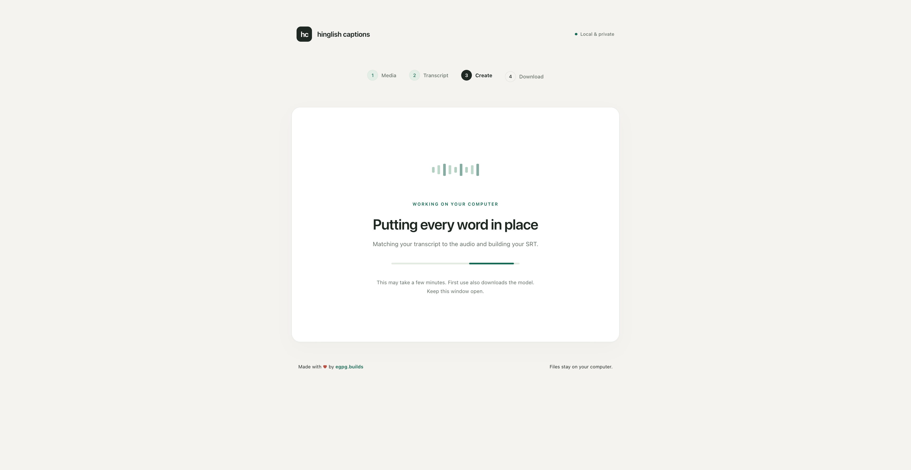
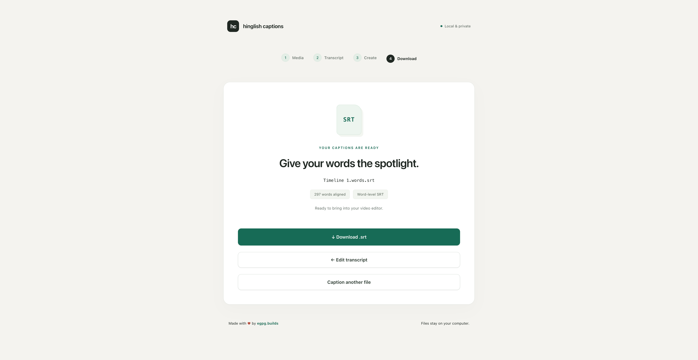

# Hinglish Captions

**Free, local, word-by-word SRT captions for Roman Hinglish audio and video.**

Most caption tools come with a subscription, usage credits, export limits, or a workflow designed around English. Even when they transcribe Hindi speech, Roman Hinglish spelling and code-switching often need manual correction—and standard SRT exports usually group several words into each caption.

Hinglish Captions solves that specific workflow. Give it your audio or video and an accurate transcript, and it aligns the words to the speech to produce a word-level `.srt` file for reels and short-form video.

- **100% free and open source** under the MIT License
- **No API key, subscription, credits, or per-export fee**
- **Built for reviewed Roman Hinglish transcripts** without translating your wording
- **Word-level SRT output**—normally one spoken word per caption cue
- **Private by default**—your media and processing stay on your computer
- **Fully customizable**—clone it, change the interface or caption logic, and make it yours

> [!IMPORTANT]
> For the most accurate Roman Hinglish captions, type or upload a reviewed transcript. Whisper draft generation is included as an optional convenience, but it can miss names, slang, code-switching, and custom spellings.

## See the workflow

The screenshots are shown at full README width because the desktop captures contain generous side space. Select any image to open its full-resolution version.

### 1. Add your audio or video

Choose a local media file, transcription model, and spoken language.

<p align="center">
  <a href="assets/Hinglish-Captions-Upload-mp3.png">
    
  </a>
</p>

### 2. Provide the exact transcript

Type or paste it, upload a UTF-8 `.txt` file, or generate an optional Whisper draft and correct it before continuing.

#### Tip: prepare your transcript with ChatGPT dictation

1. Open [ChatGPT](https://chatgpt.com/) in your browser and click the dictation microphone in the message box.
2. Play your audio/video through speakers so the microphone picks it up, then stop dictation to get the transcript.
3. Copy the [Roman Hinglish + annotation prompt](prompts/annotate-transcript.txt), replace its final placeholder with the transcript, and send it. This converts Hindi to Roman Hinglish and adds bold, italic, and highlight tags in one response.
4. Review the result and paste it into Hinglish Captions, or save it as a `.txt` file and upload it.

<p align="center">
  <a href="assets/Hinglish-Captions-transcript.png">
    
  </a>
</p>

### 3. Create the captions

The app matches the reviewed words to the speech and shows progress while it builds the SRT.

<p align="center">
  <a href="assets/Hinglish-Captions-create.png">
    
  </a>
</p>

### 4. Download the SRT

Download the finished word-level `.srt`, revise the transcript, or start another file.

<p align="center">
  <a href="assets/Hinglish-Captions-download.png">
    
  </a>
</p>

## Quick start

### Requirements

- [Python 3.11](https://www.python.org/downloads/) recommended (3.10–3.12 supported)
- [FFmpeg](https://ffmpeg.org/download.html)
- [Git](https://git-scm.com/downloads)

### macOS or Linux

```sh
git clone https://github.com/Xorawar/hinglish-captions.git
cd hinglish-captions
./run.sh
```

On macOS with Homebrew, install the requirements first with:

```sh
brew install python@3.11 ffmpeg git
```

### Windows

Install Python and FFmpeg if needed:

```powershell
winget install Python.Python.3.11
winget install Gyan.FFmpeg
winget install Git.Git
```

Then run:

```powershell
git clone https://github.com/Xorawar/hinglish-captions.git
cd hinglish-captions
.\run.bat
```

The launcher creates an isolated `.venv`, installs the required packages once, and opens the app on an available local port (starting at `7860`). Keep the terminal window open while using the app. Stop it with `Ctrl+C`.

> [!NOTE]
> The first setup downloads several hundred MB of machine-learning packages. The first use of each speech model downloads that model once as well; model sizes range from hundreds of MB to a few GB. Later launches reuse the local environment and downloaded models.

## Which transcript option should I use?

| Option | Best for | Accuracy |
| --- | --- | --- |
| **Type or paste** · Recommended | A transcript you already have in a document or chat | Best when reviewed |
| **Upload `.txt`** · Recommended | A saved UTF-8 transcript | Best when reviewed |
| **Generate with Whisper** · Optional | Creating a rough first draft locally | Varies; always review it |

The transcript should contain the words exactly as spoken, including repetitions and filler words. Do not translate, summarize, or rewrite it. Punctuation can remain attached to words.

Automatic generation may take several minutes, depending on the file, model, and computer. Its progress appears in the interface, and you can cancel it to return to typing or uploading a transcript.

## Model guide

| Model | Choose it when | Tradeoff |
| --- | --- | --- |
| `small` | You have a lower-memory computer or want a quicker draft | Faster, usually less accurate |
| `medium` | You want a practical default | Balanced speed and quality |
| `large-v3` | Accuracy matters more than processing time | Slowest and most memory-intensive |

The model is reused for draft transcription and alignment while the app is running. Processing uses the available device automatically.

## What you get

The app creates an `AUDIO.words.srt`-style file that you can import into video editors that support SRT captions. Genuine pauses remain empty instead of being filled with invented timing.

The output is normally one whitespace-separated word per cue. If the aligner returns a word with zero duration, the exporter safely joins it to the next timed cue rather than creating an invalid caption. Review the final captions in your video editor before publishing.

## Privacy and local storage

- The server listens only on `127.0.0.1`; it does not create a public share link.
- Audio, video, transcripts, and caption generation stay on your computer.
- No OpenAI API key or other paid cloud service is required.
- Generated download files use a temporary directory and are removed when the app exits.
- Virtual environments, model weights, media, secrets, caches, and generated captions are excluded from Git.

## Customize or contribute

This project is intentionally open source. Fork it for your own language, caption style, interface, or creator workflow.

- `captioner/app.py` — browser workflow and UI components
- `captioner/ui.css` — colors, typography, layout, and responsive styling
- `captioner/captioner_cli/local_workflow.py` — local models, transcription, and alignment
- `captioner/captioner_cli/srt_generator.py` — word-level SRT generation and validation

Please open an issue with a reproducible example or submit a focused pull request. Do not commit virtual environments, downloaded models, private media, transcripts, or generated exports.

For the command-line workflow, timing rules, known limitations, and backend details, read the [technical documentation](captioner/README.md).

## Run the tests

```sh
cd captioner
python -m unittest discover -s tests -v
```

The automated tests mock the speech backends. They verify application behavior and timing validation, but they do not measure transcription or alignment accuracy on real recordings.

## Known limitations

- Roman Hinglish and Hindi–English code-switching remain difficult for speech models.
- A correct transcript improves wording, but difficult audio, music, overlapping speakers, or heavy noise can still affect timing.
- CPU processing—especially with `large-v3`—can be slow.
- The original media timing must match the edit timeline; trimming silence or changing speed can shift captions.

## Creator

Made with ♥ by [egpg.builds](https://www.instagram.com/egpg.builds/) (Sachin Yadav).

## License

Released under the [MIT License](LICENSE). You may use, modify, and redistribute it under the license terms.
